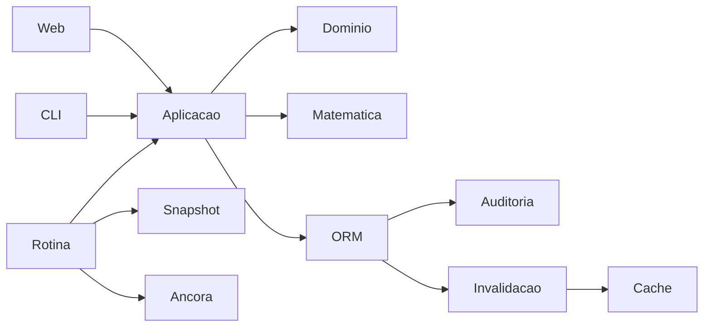

# Arquitetura atual

Fase 7: [carga de 100 usuários, cache e cadastro inicial](RELATORIO_FASE7_CARGA_CACHE.md).

Fase 6: [consolidação de acesso, cenários de 30 dias e orientação](RELATORIO_FASE6_CONSOLIDACAO.md).

Django 5.2; domínio e matemática independentes de HTTP, aplicação compartilhada por
web/CLI/rotinas, persistência no ORM e infraestrutura de fontes/arquivos.

Gravação e auditoria de modelos de domínio compartilham transação. Um callback por
transação externa invalida cache; não exporta CMDB nem resolve risco por evento.
A fila on_commit também cobre rollback de savepoints. Exportação exige destino
explícito e é auditada. Dados operacionais, chaves e bancos não pertencem ao Git.

O recomendador conserva antígenos legados, mas exclui categoria/vetor e tokens de
versão dos eixos de similaridade. Produto e major/minor conhecidos são guardas;
CPE/faixa conhecida vem antes da hipótese. VEX exige produto e justificativa.
Aprendizagem usa Incidencia.software ou candidato único; ambiguidade não escolhe
componente por ordem. Força decai apenas na prioridade; memória de origem aberta,
em tratamento ou aceita não expira. Arquivamento/perda permite reaprendizado.
População conta ativos; linha de base exige scan e permissão. Revogação reativa
memórias cujo motivo de descarte deixou de valer.

Ciclo: aprendizagem limitada, snapshot de perfis, cálculo fora da transação de
escrita e aplicação curta validada pela cabeça da auditoria. Escrita concorrente
adia o lote; cursor rotativo limita trabalho e não expira sugestões fora do lote.

Leontief usa CSR/LU esparsa; API mantém representação densa sob solicitação de
serialização. Diagnósticos densos automáticos só até 300 nós. Pontos de risco não
são probabilidades. CVSS 3.1 base tem referência exaustiva independente; Environmental
mapeia CIA 1→Low, 2→Medium, 3/4→High para prioridade/SLA. 3.0/v4 preservam score da
fonte. Snapshots regulares usam integração ZOH e tendência por regressão em janela
mínima. AST é interpretada diretamente, sem eval/compile; EDO usa Euler/RK4.

Aceites/encerramentos sensíveis permanecem TRATAMENTO enquanto aguardam segundo
usuário. Evidência, autoria e tetos são validados; Admin passa pelo serviço e deixa
campos protegidos readonly. Web e CLI exigem TOTP para staff/aprovadores e limitam
sessão. Reautenticação recente antecede POSTs privilegiados na web.

Auditoria v1 SHA-256 permanece histórica; novos elos v2 HMAC. Triggers SQLite
impedem UPDATE/DELETE. Âncoras assinadas são replicáveis por syslog; proteção contra
administrador do banco depende da cópia externa e da guarda da chave.
Backups lógicos Fernet preservam microssegundos e removem sessões expiradas da
cópia. Restauração cria SQLite novo e confere a cadeia. PostgreSQL é opção de
configuração com driver externo à lista de dependências autorizadas.

Produção usa preparação, web e agendador separados. Liveness pública não acessa
ORM/disco; detalhes exigem permissão. Docker combina HTTP e heartbeat.
Módulos de F2/3 são laboratório puro e não são importados pelos serviços de produção.
ADRs 009–012 descrevem integrações futuras, sem executá-las.

## Relações por camada (fase 4)

`RelacaoAtivos` registra evidências dirigidas de rede, identidade e negócio, sem alterar `Dependencia` ou a matriz ponderada de risco. `aplicacao/relacoes.py` concentra autorização, gravação com controle de versão e recorte de análise; `dominio/grafo_relacoes.py` calcula BFS, componentes fortemente conexas e cenários em memória. Web/API e terminal chamam o mesmo serviço.

O contexto SSVC recebe apenas o hash das relações incidentes ao ativo, calculado progressivamente; não expõe as identidades/evidências do módulo. Backup e exportação completa incluem as relações. A migração 0025 cria tabela, restrições e índice sem inferir dados de cadastros legados. Consulte [escopo, semântica, limites e homologação](RELATORIO_FASE4_RELACOES.md).

## Qualidade e cobertura (fase 5)

PerimetroRelacoes e MembroPerimetro definem os ativos esperados de um escopo. RevisaoCobertura acrescenta avaliações históricas por ativo/camada/principal. O serviço de cobertura compartilha o recorte e a elegibilidade do grafo; o domínio calcula contexto, estado e proporções com denominador explícito. A API, a web e o terminal usam os mesmos serviços.

Declarar um perímetro limita os nós dos grafos do escopo correspondente; escopos legados sem perímetro preservam o comportamento anterior com aviso. A migração 0026 não infere membros ou revisões. SSVC recebe somente hashes; backup e exportação completa incluem as três tabelas. Consulte [semântica, permissões e testes](RELATORIO_FASE5_COBERTURA.md).

## Consolidação (fase 6)

`aplicacao/autorizacao.py` consulta contas/permissões atuais; serviços de escrita revalidam após a trava. O contexto da CLI também exige sessão e reautenticação válidas, sem abrir prompts dentro de transações. Web mantém seu middleware de MFA e reautenticação. Controles da interface não substituem os dos serviços.

Monte Carlo usa apenas 30 dias, com EPSS recente e observação coerente em todos os vínculos elegíveis. Sem essa informação retorna indisponibilidade e pendências, sem fabricar probabilidade por CVSS/KEV. A matemática recebe entradas validadas, mantém amostras comuns para correções e retorna estatísticas/excedência do período; a aplicação acrescenta escopo, origem e hipóteses. Cache inclui modelo, dados, data e parâmetros. Não é FAIR completo nem calibração local de perdas. Web e CLI usam o mesmo serviço e contrato `sauron.montecarlo/30d-v1`.

Orientações de tarefa ficam no contexto compartilhado da web, com exemplos e próximos passos. A coleta EPSS interativa é uma ação explícita e autorizada, nunca um efeito de GET. Não houve alteração de esquema ou implantação Docker nesta fase.

## Carga e cache (fase 7)

O painel recebe DTOs de `aplicacao/painel.py`, com validade de 15s e chaves por banco,
perfil, dia e permissões de alertas/certificados. Não se compartilha HTML, sessão ou
autorização. Sinais invalidam a geração após commit; transações com alterações pendentes
não publicam o resumo. Risco e Monte Carlo preservam suas chaves de versão/parâmetros.
Travas por família evitam reconstruções simultâneas do mesmo cálculo no mesmo host.

O backend de arquivos substitui resultados atomicamente e repete erros transitórios de
handle no Windows, sem copiar por cima de arquivos lidos. O namespace de cache é versão 2.
`aquecer_cache` prepara as análises locais e é chamado por `preparar_servidor`; financeiro
é opcional. O batimento de atividade da sessão grava no máximo a cada 30s em leituras,
sem adiar a expiração ou reutilizar permissões de requisições anteriores.

O bootstrap `cadastrar_administrador` compartilha serviço com o primeiro cadastro CLI,
usa trava de escrita e rejeita um segundo administrador inicial. Não requer MFA para criar
essa primeira conta e não cria sessão. O acesso subsequente segue a política de MFA.

