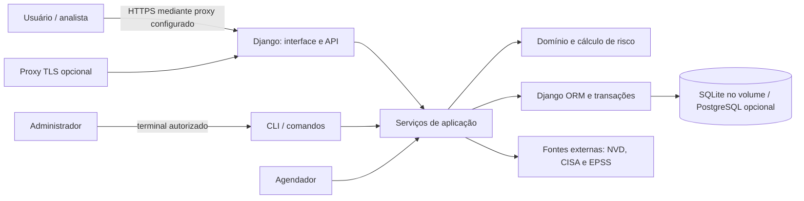

# Sprint 5 — arquitetura, acesso e segurança

[← Rastreabilidade](SPRINT5_RASTREABILIDADE.md) · [Arquitetura e ADRs](ARQUITETURA.md)

## Arquitetura e decisões

As entidades operacionais são modelos relacionais Django. `Ativo` guarda o tipo em uma coluna; a conversão para objetos do domínio usa subclasses `Servidor`, `Roteador` etc. Uma tabela única evita várias junções para o inventário comum, enquanto polimorfismo do domínio especializa o comportamento. `Ativo` e `Vulnerabilidade` são N:N por meio de `Incidencia`, que também guarda status, prazos e evidência. `Sala` é 1:N; `Dependencia` relaciona ativos com pesos. Cada gravação relevante compartilha transação e auditoria. Migrações Django evoluem o esquema.

O repositório JSON e o repositório em memória são didáticos. A aplicação multiusuário usa ORM diretamente em partes da camada de aplicação; não existe uma interface única comprovadamente intercambiável com JSON. Substituir o ORM por SQLAlchemy/Alembic ou adicionar uma segunda cópia de banco não é necessário para obter banco relacional, e exigiria projeto e testes de migração próprios. PostgreSQL é opcional e não foi testado nesta revisão. SQL manual pode ser apropriado para agregações específicas; entradas sempre devem ser parâmetros, não fragmentos concatenados.

## Permissões e sessão

O comando `configurar_grupos` é a fonte concreta da matriz abaixo. Permissões individuais adicionais podem alterar o resultado; as próprias rotas e serviços exigem permissões específicas.

| Perfil | Comportamento padrão | Limite importante |
|---|---|---|
| Sem sessão | Apenas login e liveness públicos | API v1 devolve 401. |
| Autenticado sem MFA | Encaminhado ao segundo fator | API v1 devolve 403 até verificar MFA. |
| Operadores | Leituras selecionadas, alteração de incidência e ações operacionais específicas | Não recebem administração de contas; decisões sensíveis têm regras próprias. |
| Auditores | Permissões `view_` do inventário | Não têm escrita por padrão. |
| Gerentes | Permissões de negócio e leitura de trilhas | Algumas ações exigem permissões e verificações adicionais. |
| Superusuário | Administração e permissões amplas | MFA e reautenticação continuam no fluxo web; cuidar especialmente da conta. |

O inventário é compartilhado, não multiempresa: permissão de leitura não significa isolamento por proprietário ou organização. Controle por objeto/tenant exige desenho adicional. Cookies `HttpOnly` e `SameSite=Lax` estão configurados; `Secure`, HTTPS e HSTS dependem da configuração de produção. SameSite ajuda a reduzir envios automáticos entre sites, mas não substitui CSRF. Sessões têm limites absoluto e ocioso, e a confirmação do segundo fator é por sessão.

## Senhas

O primeiro administrador é criado localmente pelo comando documentado; a criação não abre uma sessão. Novas senhas usam Argon2id com o hasher do Django e sal aleatório. Hashes anteriores suportados continuam verificáveis e, após verificação correta, são atualizados para o algoritmo preferido. O projeto usa validadores de similaridade com dados do usuário, tamanho mínimo do Django, senha comum e senha inteiramente numérica; não se deve dizer que isso representa conformidade integral com uma edição do NIST. Não há pepper. Senhas devem ser longas, únicas e guardadas em gerenciador; MFA complementa a senha. Instalações antigas precisam instalar as dependências atualizadas antes de iniciar a nova versão.

## Análise OWASP Top 10:2025

Os CWE abaixo são exemplos pertinentes para análise, não certificações nem comprovação de que o Sauron possui cada falha. A lista oficial é [OWASP Top 10:2025](https://top10.owasp.org/2025/pt-BR/); definições em [MITRE CWE](https://cwe.mitre.org/).

| Categoria | Exemplo / CWE | Situação identificada e ação |
|---|---|---|
| A01 Controle de acesso quebrado | Acessar recurso de outro usuário; CWE-639 | Rotas e serviços verificam permissões; inventário é compartilhado. Definir escopo por objeto antes de atender organizações distintas. |
| A02 Configuração insegura | Produção com debug ou TLS desativado; CWE-16 | Checagens e opções seguras existem, mas configuração efetiva depende do servidor. Conferir `check --deploy`, proxy e cookies no ambiente real. |
| A03 Cadeia de suprimentos | Dependência/imagem desatualizada; CWE-1104 | pip-audit local limpo para dependências Python; scan anterior encontrou CVEs de SO. Imagem atualizada requer nova varredura e avaliação. |
| A04 Falhas criptográficas | Senha armazenada sem proteção; CWE-256 | Argon2id para novas senhas e upgrade de hashes; backups cifrados. Gestão de chaves e disco dependem do operador. |
| A05 Injeção | Entrada altera SQL; CWE-89 | ORM e SQL manual examinado usam parâmetros; teste de busca maliciosa acrescentado. Outras entradas e integrações exigem revisão contínua. |
| A06 Design inseguro | Fluxo de recuperação que contorna autorização; CWE-841 | Bootstrap só cria primeiro superusuário e exige acesso local. Planejar recuperação, segregação e ameaças antes de integrações externas. |
| A07 Autenticação | Ataques repetidos a senhas; CWE-307 | Limites de login persistentes e MFA existem; testes locais não provam resistência sob ataque distribuído real. |
| A08 Integridade de software/dados | Dados alterados sem validação; CWE-345 | Auditoria encadeada e migrações; âncora externa e proteção de chave são dependências operacionais. |
| A09 Registros e alertas | Tentativas de acesso sem registro; CWE-778 | Eventos e alertas existem; entrega, retenção e resposta no servidor precisam ser verificadas. |
| A10 Condições excepcionais | Erro interno expõe detalhes; CWE-209 | Removida exibição de `IntegrityError` de banco no formulário, com teste. Revisão de todos os manipuladores permanece necessária. |

**Prioridade sem inventar scores:** tratar primeiro a imagem e CVEs com correção conhecida, considerando exposição real e dados oficiais; em seguida API de escrita/autenticação e controles no servidor. CVSS mede severidade técnica, não risco da empresa isoladamente; KEV, EPSS, exposição, criticidade e evidência contextual devem orientar a ordem. Na CI, a imagem original registrou 139 itens (130 altos e 9 críticos); a base Debian mais recente registrou 47 altos e nenhum crítico. Esses números incluem itens sem correção e não demonstram que todos sejam exploráveis na aplicação. A varredura continua reprovada devido aos itens altos.

## STRIDE inicial

| Ameaça | Exemplo | Controle / trabalho em aberto |
|---|---|---|
| Identidade falsa | roubo de senha ou sessão | MFA, limitação e cookies; validar operação e recuperação reais. |
| Alteração | editar dados ou auditoria indevidamente | permissões, transações e cadeia HMAC; proteger âncoras externas e chaves. |
| Repúdio | negar ação administrativa | autoria e logs; garantir coleta e proteção fora do host. |
| Divulgação | leitura sem direito ou erro detalhado | permissões, MFA e erros genéricos; projetar isolamento entre organizações. |
| Negação de serviço | cálculos caros ou muitas tentativas | limites e cache; medir capacidade e conter abuso em ambiente real. |
| Elevação de privilégio | operador acessa gestão de contas | permissões no servidor e testes; revisar novas rotas e integrações. |

## Operação no servidor compartilhado

Use [o guia Docker](DOCKER_TRABALHO_2.md). Antes de mudar SSH, firewall ou serviços globais, combine com o administrador do servidor. Não faça alterações em recursos de outros alunos. A identificação da matrícula e a prova de 24 horas são coisas diferentes: a primeira foi configurada; a segunda ainda precisa ser observada de fato. O acesso e o domínio informados não comprovam HTTPS, backup restaurável, operação contínua ou produção segura.
